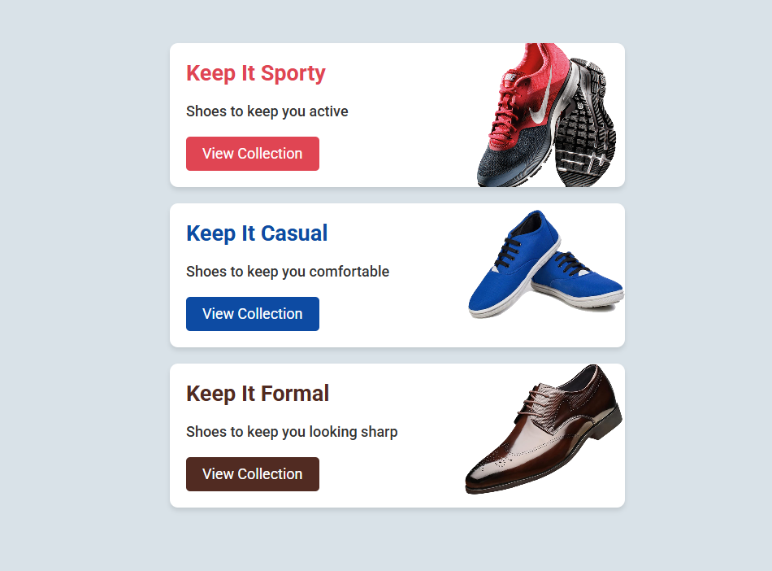

<div align="center">

# 👟 Shoe Card Project

### A Simple Shoe Collection Showcase with HTML & CSS

A mini project that presents sporty, casual, and formal shoe collections through three clean card layouts. It practices the CSS box model, spacing, background images, typography, and styled call-to-action buttons.

<p>
  
  
  
</p>

</div>

---

## 📸 Project Preview

<p align="center">
  
</p>

---

## Features

- **Three Shoe Categories:** Displays separate cards for **Sporty**, **Casual**, and **Formal** collections, each with its own heading and short description.
- **Category-Specific Styling:** Uses different heading and button colors to visually distinguish each shoe category.
- **Background Product Images:** Places a shoe image on the right side of each card using CSS background properties, including image positioning and sizing.
- **Card UI Design:** Applies **padding**, **margin**, **rounded corners**, and **box shadows** to create clear separation between cards.
- **Styled Call-to-Action Buttons:** Each card includes a “View Collection” link with category-matched colors and a hover opacity effect. The links currently use `href="#"` as placeholders.
- **Readable Typography:** Uses the **Roboto** font from Google Fonts and a centered, max-width container to keep the content organized.

## Project Structure

```text
10_shoe-card-project/
├── index.html
├── styles.css
├── images/
│   ├── sporty.png
│   ├── casual.png
│   └── formal.png
├── screenshots/
│   └── shoe-card-preview.png
└── README.md
```

## What I Practiced

- **HTML Structure:** Organizing repeated content with containers, headings, descriptions, and links.
- **CSS Box Model:** Using `margin`, `padding`, `max-width`, and `box-sizing` to control the layout and spacing.
- **Background Images:** Positioning and sizing decorative images with `background` properties.
- **Visual Styling:** Applying category-specific colors, `border-radius`, `box-shadow`, and hover effects.
- **Typography:** Importing and using the **Roboto** font to improve readability.

---

<p align="center"><strong>Built as part of my Modern HTML & CSS learning journey.</strong></p>
