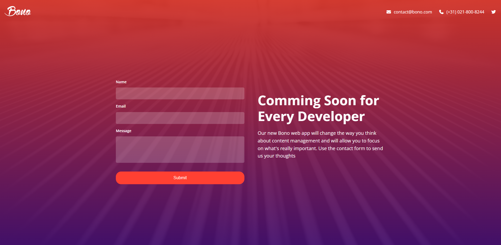

<div align="center">

# BONO Landing Form

### Coming Soon for Every Developer

A responsive promotional landing page for the BONO web app, featuring a bold product introduction and a contact form. This mini-project practices **HTML structure**, **CSS styling**, and **Flexbox layouts** while arranging contact details, form fields, and hero content into a clean, responsive interface.

<p>
  <a href="https://bono-landingform.vercel.app/"><strong>View Live Website</strong></a>
  ·
  <a href="https://github.com/mhsakibb/Modern-HTML-CSS_Udemy/tree/main/Section%2009%20-%20Landing%20Form%20Mini-Project/Bono-Landing_Form"><strong>View Source Code</strong></a>
</p>

<p>
  
  
  
  
  
</p>

</div>

---

## Project Preview

<p align="center">
  <a href="https://bono-landingform.vercel.app/">
    
  </a>
</p>

---

## Key Features

- **Promotional Hero Section:** Introduces the BONO web app with the headline “Coming Soon for Every Developer” and supporting product copy.
- **Contact Form Interface:** Includes **Name**, **Email**, and **Message** fields plus a **Submit** button for the form layout.
- **Contact Details:** Shows an email address and telephone number in the header, alongside a social-media icon link.
- **Flexbox Layout:** Uses Flexbox to align header content and arrange the form and promotional text in two columns on wider screens.
- **Responsive Design:** CSS media queries adapt the header and main content for smaller screens, stacking the layout vertically.
- **Visual Styling:** Uses a full-page background image with a gradient overlay, translucent form fields, and a contrasting call-to-action button.

## Project Structure

```text
Bono-Landing_Form/
├── index.html
├── css/
│   └── styles.css
├── images/
│   ├── background.jpg
│   ├── favicon.png
│   └── logo.svg
├── screenshots/
│   └── bono-landing-form-preview.png
└── README.md
```

## Built With

- **HTML5** — page structure, contact form, and semantic content.
- **CSS3** — colors, background overlay, typography, spacing, and form styling.
- **CSS Flexbox** — alignment and responsive two-column layout.
- **CSS Media Queries** — layout adjustments for mobile and shorter screens.
- **Font Awesome** — email, phone, and social icons.
- **Google Fonts (Open Sans)** — typography.

## What I Learned

- Building a landing page with a clear **hero message** and call to action.
- Creating and styling **form inputs**, labels, a textarea, and a submit button.
- Using **Flexbox** to align and organize page content.
- Applying **responsive design** with CSS media queries.
- Combining **background images**, gradient overlays, and translucent UI elements.


## Note About the Form

The project demonstrates the **front-end contact form interface**. The HTML currently does not specify a form submission endpoint or backend service, so the presence of the form alone does not mean messages are delivered or stored.

---

<p align="center"><em>Part of my Modern HTML &amp; CSS From The Beginning 2.0 learning journey.</em></p>
