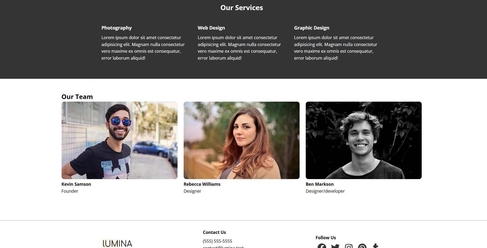

<div align="center">

# LUMINA Website

### Passionate creatives crafting distinct projects, driven by innovation

A responsive creative agency portfolio website showcasing visual projects, creative services, team members, and contact information in a clean, modern layout.

<p>
  
  
  
  
  
  
</p>

</div>

---
## Go To LUMINA: https://modern-html-cssudemy-lumina-creativ.vercel.app/

## Project Overview

**LUMINA** is a multi-page portfolio website for a creative agency, featuring a visual project gallery, company services, team profiles, and a contact form. The layout is built with HTML and CSS, with **Lightbox2** providing an image-viewing overlay for portfolio work.

## Project Structure

```text
lumina-creative-project/
│
├── index.html             # Home page and creative portfolio gallery
├── about.html             # Agency services and team members
├── contact.html           # Contact form
│
├── css/
│   └── styles.css         # Site styles, layouts, and responsive rules
│
├── images/
│   ├── logo.png
│   ├── favicon.ico
│   ├── portfolio1.jpg ... portfolio9.jpg
│   ├── image1.jpg ... image9.jpg
│   └── team1.jpg ... team3.jpg
│
├── screenshots/
│   ├── 01-creative-gallery.png
│   └── 02-about-services-team.png
│
└── README.md
```

## Key Features

### 1. Creative Portfolio Gallery

The homepage presents portfolio images in a flexible gallery layout. Visitors can select an image to open a larger view through **Lightbox2**, making the work easier to explore. The gallery uses a **Flexbox layout**, image spacing, rounded corners, and a subtle hover effect.

<p align="center">
  
</p>

<p align="center"><em>Screenshot 1 — Homepage and portfolio gallery</em></p>

### 2. Services and Team Showcase

The About page introduces the agency's core services — **Photography, Web Design, and Graphic Design** — alongside a team section with member portraits and roles. Responsive CSS rules adapt the layout for smaller screens.

<p align="center">
  
</p>

<p align="center"><em>Screenshot 2 — Services and team sections</em></p>

## Technologies & Tools

- **HTML5** — semantic structure for the pages and contact form.
- **CSS3** — styling, Flexbox layouts, CSS custom properties, and responsive media queries.
- **JavaScript / jQuery** — supports the interactive behavior provided by the included libraries.
- **Lightbox2** — opens portfolio images in an overlay for focused viewing.
- **Font Awesome** — social media icons in the footer.
- **Google Fonts (Open Sans)** — consistent typography across the website.

## How to Run the Project

1. Download or clone the repository.
2. Open the `lumina-creative-project` folder in **Visual Studio Code**.
3. Open `index.html` with the **Live Server** extension, or open the file directly in a browser.
4. Use the navigation menu to visit the Home, About, and Contact pages.

The project loads jQuery, Lightbox2, Font Awesome, and Google Fonts from external CDNs, so an internet connection is needed for those resources to load.

## What You Can Learn

- Build multi-page websites using **semantic HTML** and consistent navigation.
- Create responsive layouts with **CSS Flexbox**, reusable styles, and **media queries**.
- Add interactive image previews with the **Lightbox2 library** and organize external frontend dependencies.
- Design portfolio galleries, service sections, team profiles, and accessible form labels using core **frontend development** practices.
