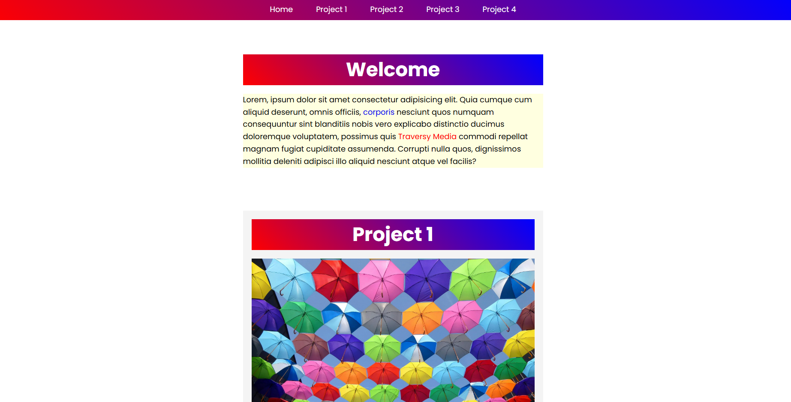

<div align="center">

# Smooth Scroll Mini-Project — CSS Selectors Challenge

### Practice smooth in-page navigation and advanced CSS selectors

A follow-up version of the Smooth Scroll mini-project from Section 10, updated through the Section 14 selectors challenge. This project combines smooth scrolling between page sections with practical CSS selector rules to style specific elements based on their position, relationship, attributes, and parent content.

<p>
  
  
  
</p>

<p>
  <a href="https://smooth-scroll-mini-project.vercel.app/"><strong> View Live Website</strong></a>
  ·
  <a href="https://github.com/mhsakibb/Modern-HTML-CSS_Udemy/tree/main/Section%2014%20-%20Advanced%20Selectors%20-%20Pseudo%20Classes%20and%20Elements/10_selectors-challenge"><strong>View Source Folder</strong></a>
</p>

</div>

---

## Project Preview

<p align="center">
  
</p>

## Key Features

- **Smooth In-Page Navigation:** A fixed header menu links to Home and Project 1–4 sections, while `scroll-behavior: smooth` makes navigation scroll smoothly to each target.
- **Advanced Element Selectors:** Uses `:first-of-type` and `:nth-child()` to style paragraphs and alternate list-item backgrounds based on element position.
- **Relational Selectors:** Uses `:has(img)` to style sections containing images and the adjacent-sibling selector `ul + p` to target a paragraph immediately following a list.
- **Attribute Selectors:** Selects links whose `href` begins with `http://` or `https://` and applies a distinct text color.
- **Targeted Selector Combinations:** Combines section, paragraph, and link selectors to apply bold styling to specific elements.
- **Consistent Visual Styling:** Includes a gradient navigation header and section headings, a centered content container, Poppins typography, and image-based project sections.

## Project Structure

```text
10_selectors-challenge/
├── index.html
├── styles.css
├── project1.jpg
├── project2.jpg
├── project3.jpg
├── project4.jpg
├── screenshots/
│   └── selectors-challenge-preview.png
└── README.md
```

## What I Practiced

- **Smooth scrolling** and in-page navigation using HTML anchor links and CSS.
- **Pseudo-classes** such as `:first-of-type` and `:nth-child()`.
- **Relational selectors** including `:has()` and the adjacent-sibling combinator (`+`).
- **Attribute selectors** and combining selectors to target specific elements precisely.
- **CSS layout fundamentals**, including Flexbox, spacing, typography, backgrounds, and the universal box-sizing reset.

---

<p align="center"><i>Part of my Modern HTML & CSS From The Beginning 2.0 learning journey.</i></p>
