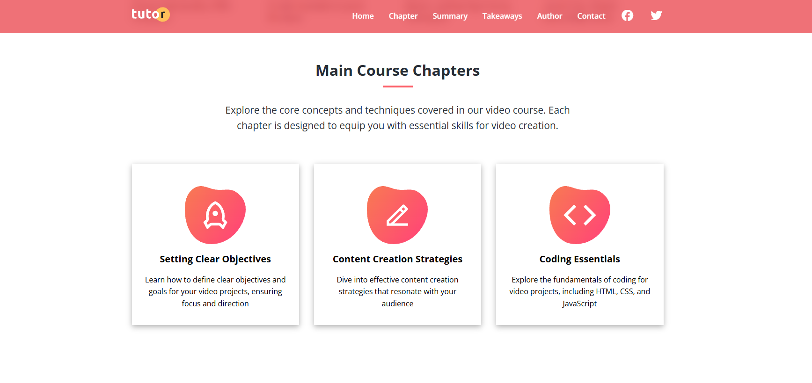

<div align="center">

# TUTOR Website

### Create Your Own Video Courses

Dive deep into the world of creativity and learn to craft stunning videos that captivate your audience.

<p>
  
  
  
  
  
</p>

</div>

---
## Go To TUTOR: https://tutor-website-nu-six.vercel.app/

## About the Project

**TUTOR** is a responsive, course-focused website that introduces visitors to a video-course learning experience. It presents learning topics, course chapters, a course summary, key takeaways, and author information through a clean, section-based layout. A dedicated contact page provides a message form and an embedded map, while JavaScript adds a mobile navigation menu and a scroll-responsive navbar.

## Project Structure

```text
Tutor Website/
├── index.html                  # Main course landing page
├── contact.html                # Contact page with message form and map
├── css/
│   └── styles.css              # Main styles, layouts, and responsive rules
├── js/
│   └── script.js               # Mobile menu and navbar scroll interaction
├── images/
│   ├── logo.svg
│   ├── favicon.png
│   ├── header-background.jpg
│   ├── header-course.png
│   ├── description-*.jpg        # Learning-topic images
│   ├── chapters-icon-*.svg     # Course chapter icons
│   └── ...                     # Other course, author, and statistics images
└── screenshots/
    ├── 01-homepage-hero.png    
    ├── 02-course-content.png   
```

## Key Features

### 1. Responsive Course Landing Page

The homepage introduces the course with a prominent hero section, a call-to-action, and a visual learning-topic grid. The navigation links guide visitors to key sections of the page. The layout adapts to smaller screens with a mobile menu, and the navbar changes appearance when the visitor scrolls.

<p align="center">
  
</p>
<p align="center"><em>Homepage and hero section — replace this image by adding your screenshot as <code>screenshots/01-homepage-hero.png</code>.</em></p>

### 2. Course Chapters and Learning Content

The course area organizes information into chapter cards, a structured summary, and key-takeaway cards. These sections demonstrate how related learning content can be arranged in a consistent, easy-to-scan layout using reusable styling and responsive grids.

<p align="center">
  
</p>
<p align="center"><em>Course chapters and learning content — replace this image by adding your screenshot as <code>screenshots/02-course-content.png</code>.</em></p>

## Technologies and Tools

- **HTML5** — semantic page structure and content.
- **CSS3** — visual styling, CSS custom properties, Flexbox, Grid, and responsive layouts.
- **JavaScript** — toggles the mobile navigation menu and updates the navbar on scroll.
- **Font Awesome** — social, navigation, and feature icons.
- **Google Fonts** — Open Sans typography.
- **Google Maps embed and Formspree** — external map and contact-form integration used on the contact page.

## What You Can Learn From This Project

- Build a multi-section website with **semantic HTML5** and clear navigation between pages.
- Create polished layouts with **CSS3**, **Flexbox**, **CSS Grid**, and **responsive design** techniques.
- Add simple user interactions through **JavaScript DOM manipulation** and event listeners.
- Integrate external resources such as **Google Fonts**, **Font Awesome**, an embedded map, and a contact form service.

---

<div align="center">
  <sub>Built as a front-end learning project while practicing modern HTML, CSS, and JavaScript.</sub>
</div>
