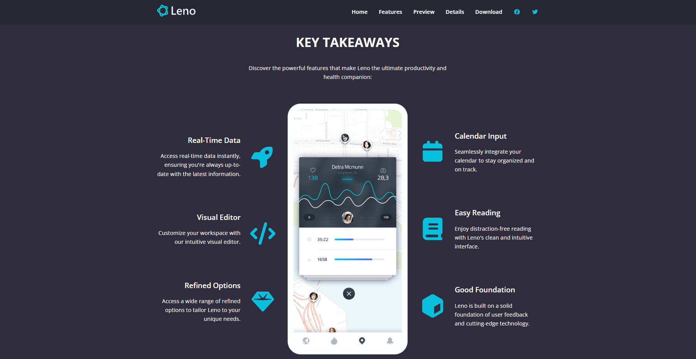
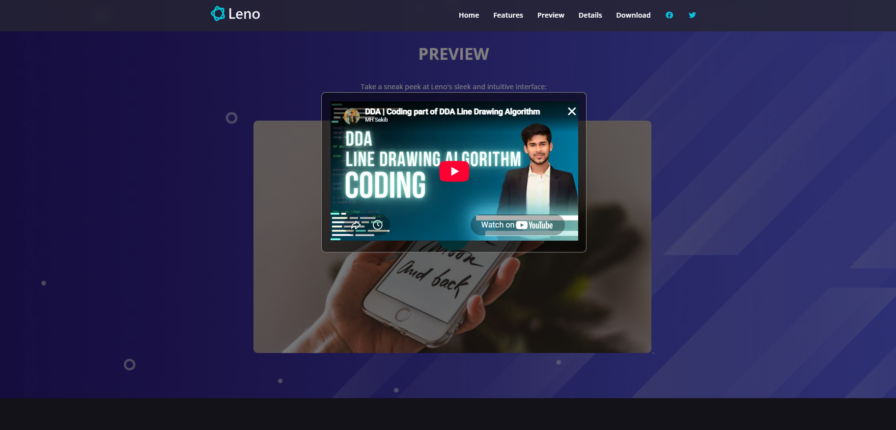

<div align="center">
  <h1>LENO Website</h1>
  <h3>Your Productivity Assistant</h3>
  <p>
    Boost your productivity and improve your health with Leno - the all-in-one app for developers and creators.
  </p>

  <p>
    
    
    
    
    
  </p>
</div>

---

## Go to LENO: https://leno-website-sooty.vercel.app/ 

## About the Project

LENO presents a Rwsponsive Website through a modern, dark-themed landing page. Its layout guides visitors through the site's value proposition, key features, user testimonials, a video preview, app details, and download calls to action. A separate details page includes pricing options. The project is built with **HTML5**, **CSS3**, and **vanilla JavaScript**, with responsive styling and the **BEM naming convention** to keep CSS classes organized.

## Key Features

### 1. Responsive Landing Page

<!-- Screenshot path: upload your image as screenshots/01-homepage.png -->
<div align="center">
  
  <p><em>Homepage featuring the navigation bar, hero message, app imagery, and download calls to action.</em></p>
</div>

- **Hero section** introduces LENO as a productivity assistant.
- **Navigation bar** links to the main website sections and changes appearance while scrolling.
- **Mobile menu** opens and closes with a hamburger toggle on smaller screens.
- **Download calls to action** guide visitors toward the Apple and Android download section.

### 2. Features and Testimonials

<!-- Screenshot path: upload your image as screenshots/02-features-section.png -->
<div align="center">
  
  <p><em>Feature highlights and testimonial cards introduce the app's benefits and user-focused design.</em></p>
</div>

- **Feature showcase** arranges key takeaways around a smartphone visual.
- **Testimonials section** displays user quotes in a three-column layout on larger screens.
- **Icon-supported content** uses Font Awesome icons to make feature items easier to scan.
- **Responsive layout** adjusts the page presentation for different screen sizes.

### 3. Interactive Video Preview


<div align="center">
  
  <p><em>The preview button opens a modal with an embedded video; the modal can be closed to return to the page.</em></p>
</div>

- **Play-button interaction** opens the video in a modal window.
- **Close control** dismisses the modal, and clicking outside the modal also closes it.
- **Video reset** clears the embedded video's source when the modal closes.
- **Scroll interaction** uses JavaScript to update the navigation bar's styling as the page scrolls.

> **Additional page:** Open `details.html` to explore the separate details page and its pricing cards.

## Project Structure

```text
Leno Website/
├── index.html                  # Main landing page
├── details.html                # App details and pricing page
├── css/
│   └── styles.css              # Layout, components, colors, and responsive styles
├── js/
│   └── script.js               # Mobile menu, video modal, and navbar scroll behavior
├── images/                     # Logos, app mockups, backgrounds, and section images
├── screenshots/                
│   ├── 01-homepage.png
│   ├── 02-features-section.png
│   └── 03-video-preview-modal.png
└── README.md
```

## Run the Project Locally

1. Open the `Leno Website` folder in **Visual Studio Code**.
2. Open `index.html` with the **Live Server** extension, or open the file directly in your browser.
3. Try the navigation links, mobile menu, video preview modal, and the link to `details.html`.

No package installation or build command is required.

## 📚 What I Learned

- **Semantic HTML:** structuring a multi-section landing page and a separate details page.
- **Responsive CSS:** building layouts with **Flexbox**, **CSS Grid**, and media queries for different screen sizes.
- **BEM methodology:** naming CSS classes with **Block**, **Element**, and **Modifier** patterns for clearer, maintainable styles.
- **JavaScript DOM manipulation:** handling click events, toggling mobile navigation, managing a video modal, and changing the navbar on scroll.
- **Frontend presentation:** combining **icons**, **typography**, images, reusable sections, and clear calls to action into a consistent website experience.
