<h1 align="center">Modern HTML &amp; CSS From The Beginning 2.0</h1>

<h3 align="center">Build modern responsive websites with HTML and CSS — Learning modules, mini-projects and 3 full websites</h3>

<p align="center">
  A hands-on learning repository documenting my journey through modern frontend development, from essential HTML and CSS concepts to responsive layouts, accessibility, animations, Git/GitHub, and complete website projects.
</p>

<p align="center">
  
  
  
  
  
  
  
</p>

<p align="center">
  <a href="#-course-overview">Course Overview</a> •
  <a href="#-repository-structure">Repository Structure</a> •
  <a href="#-featured-projects">Featured Projects</a> •
  <a href="#-learning-roadmap">Learning Roadmap</a> •
  <a href="#-getting-started">Getting Started</a>
</p>

---

## Course Overview

This repository contains my practice work for **Modern HTML & CSS From The Beginning 2.0**. It is organized by course section and includes foundational examples, styling exercises, layout practice, challenges, mini-projects, and full website projects. The goal is to strengthen the fundamentals needed to build **clean**, **accessible**, **responsive**, and **maintainable** websites using core frontend technologies.

## What This Repository Covers

- **HTML Fundamentals:** document structure, semantic elements, links, images, forms, and input controls.
- **CSS Foundations:** selectors, cascade, typography, colors, spacing, borders, the box model, and positioning.
- **Modern Layouts:** **Flexbox**, **CSS Grid**, responsive units, and **media queries**.
- **Advanced Styling:** pseudo-classes, pseudo-elements, visual effects, transitions, transforms, and keyframe animations.
- **Accessibility:** semantic markup and foundational web-accessibility practices.
- **Interactivity:** introductory **JavaScript** for UI behavior and DOM styling.
- **Workflow & Deployment:** **Git**, **GitHub**, and web-hosting/deployment practice.
- **Project Building:** reusable layout patterns, **BEM** naming, and complete responsive website builds.

## Repository Structure

The tree below preserves the course section and project-folder names currently present in this repository. The individual section folders contain the lesson examples, practice files, and challenges for that topic.

```text
Modern-HTML-CSS_Udemy/
├── Section 2 - Essential HTML/
├── Section 3 - HTML Form and Input Elements/
├── Section 4 - More HTML Elements/
├── Section 5 - CSS Basics/
├── Section 6 - Box Model & Positioning/
├── Section 7 - Flexbox/
├── Section 8 - Responsive Design/
├── Section 9 - Landing Form Mini-Project/
│   └── Bono-Landing_Form/
├── Section 10 - Various CSS Features/
├── Section 11 - Lumina Creative Website Project/
│   └── lumina-creative-project/
├── Section 12 - Git GitHuub and Web Hosting/
│   └── LUMINA/  (Git submodule declared in .gitmodules)
├── Section 13 - Web Accessibilit Introduction/
├── Section 14 - Advanced Selectors - Pseudo Classes and Elements/
├── Section 15 - CSS Grid/
├── Section 16 - Transitions - Animation and A Little JavaScript/
├── Section 17-18 - Tutor Website Project/
│   └── Tutor Website/
├── Section 19-20 - Leno Website Project(BEM)/
│   └── Leno Website/
├── .gitmodules
├── screenshots/  (homepage images used in this README)
└── README.md
```

## 🌐 Featured Projects

These deployed projects are part of my practical frontend learning journey.

### 1. LENO Website

A responsive promotional website for a mobile productivity and health app. LENO showcases its features through testimonials, an interactive video preview, app screenshots, and download call-to-action sections. It also includes a separate details page with pricing plans and additional feature information, built using HTML, CSS, BEM methodology, and JavaScript interactions.

#### Home / Hero Section

The homepage introduces the LENO app with a responsive navigation bar, promotional content, smartphone visuals, and Apple and Android call-to-action buttons.

<p align="center">
  <a href="https://leno-website-sooty.vercel.app/">
    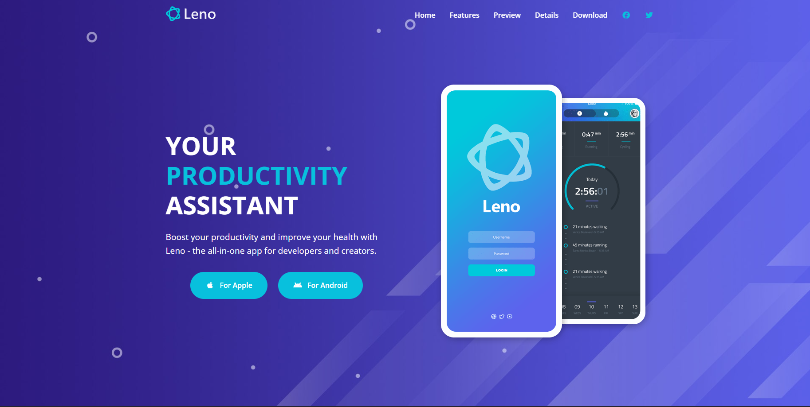
  </a>
</p>

<p align="center">
  <a href="https://leno-website-sooty.vercel.app/">
    <strong>View Live Website</strong>
  </a>
  ·
  <a href="./Section%2019-20%20-%20Leno%20Website%20Project%28BEM%29/Leno%20Website">
    <strong>View Source Folder</strong>
  </a>
</p>

#### Features Section

The Key Takeaways section highlights six app features: Real-Time Data, Visual Editor, Refined Options, Calendar Input, Easy Reading, and Good Foundation. A responsive grid layout combines feature descriptions, icons, and smartphone imagery.

<p align="center">
  <a href="https://leno-website-sooty.vercel.app/#features">
    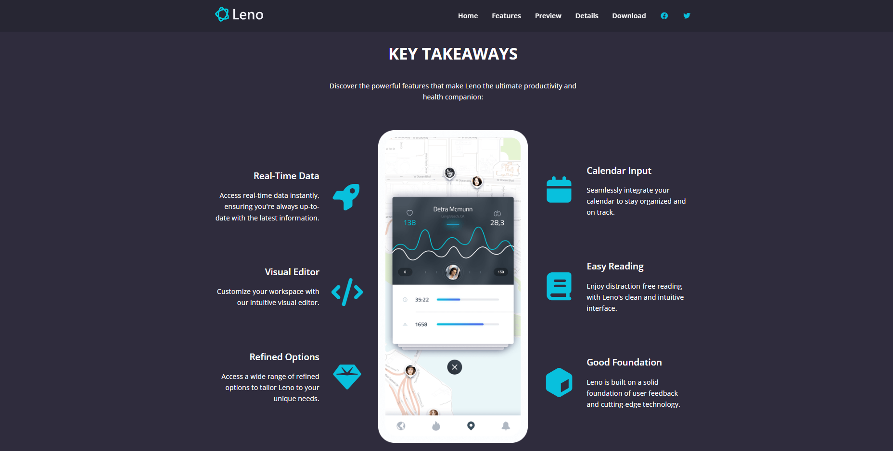
  </a>
</p>

#### Preview Section

The Preview section presents a video preview with an animated play button. Clicking the button opens a video modal, demonstrating interactive elements and JavaScript-based DOM manipulation.

<p align="center">
  <a href="https://leno-website-sooty.vercel.app/#preview">
    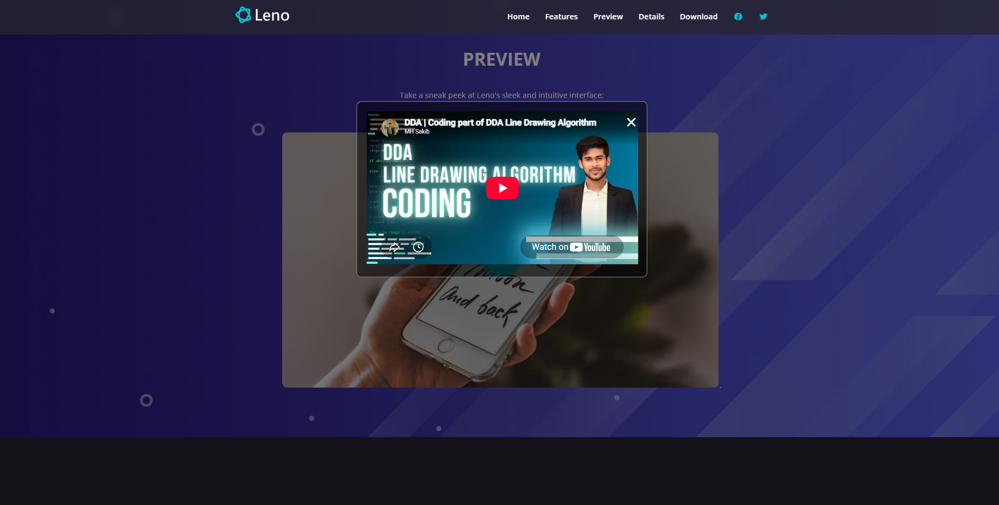
  </a>
</p>

<details>
<summary><strong>See more screenshots</strong></summary>

<br />

#### Testimonials Section

A dedicated testimonials area displays customer feedback using profile images, review text, and customer names. It demonstrates structured content presentation and a consistent card layout.

<p align="center">
  <a href="https://leno-website-sooty.vercel.app/#testimonials">
    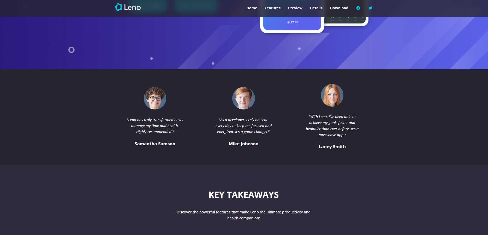
  </a>
</p>

#### Details & Statistics Section

This section combines smartphone visuals and supporting text to introduce the app's benefits, including long-term goal setting and calendar-based task scheduling. A statistics row presents example metrics such as happy customers, issues solved, reviews, case studies, and press articles.

<p align="center">
  <a href="https://leno-website-sooty.vercel.app/#details">
    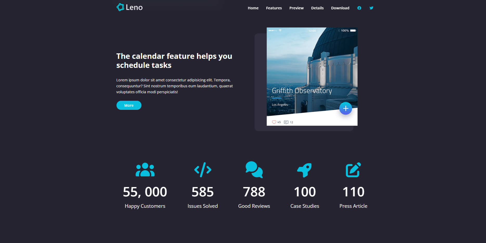
  </a>
</p>

#### App Screenshots Gallery

The Screenshots section displays a gallery of five app screenshots, showcasing the product's visual interface. It demonstrates image layout techniques and the use of a responsive gallery.

<p align="center">
  <a href="https://leno-website-sooty.vercel.app/#screenshots">
    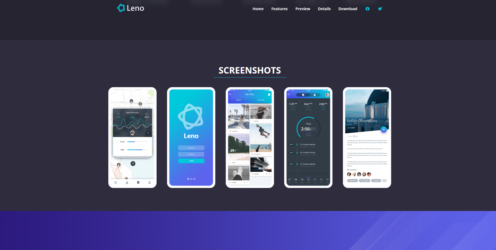
  </a>
</p>

#### Download Section

The Download section encourages visitors to explore the app through Apple and Android call-to-action buttons. In this project, both buttons navigate to the separate `details.html` page rather than directly downloading an app from an app store.

<p align="center">
  <a href="https://leno-website-sooty.vercel.app/#download">
    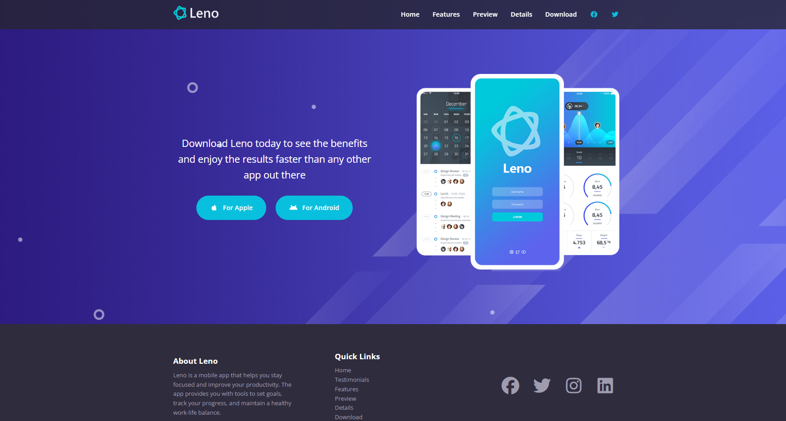
  </a>
</p>

#### Pricing Options — Details Page

The separate Details page presents three pricing cards: Standard, Advanced, and Complete. Each card displays a price, listed benefits, storage capacity, and a Get Started button, demonstrating a structured pricing-card layout.

<p align="center">
  <a href="https://leno-website-sooty.vercel.app/details.html">
    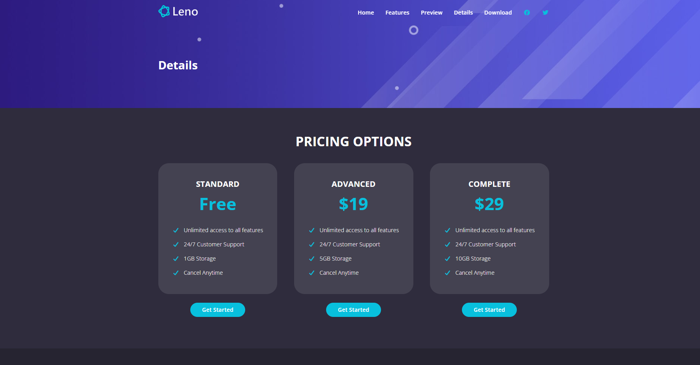
  </a>
</p>

#### Additional Features — Details Page

The Details page includes an additional Features section covering Real-Time Data, Simple Integration, Easy To Use, High Accuracy, and Reporting Tools. This section demonstrates icon-supported content layouts and reusable styling for feature descriptions.

<p align="center">
  <a href="https://leno-website-sooty.vercel.app/details.html">
    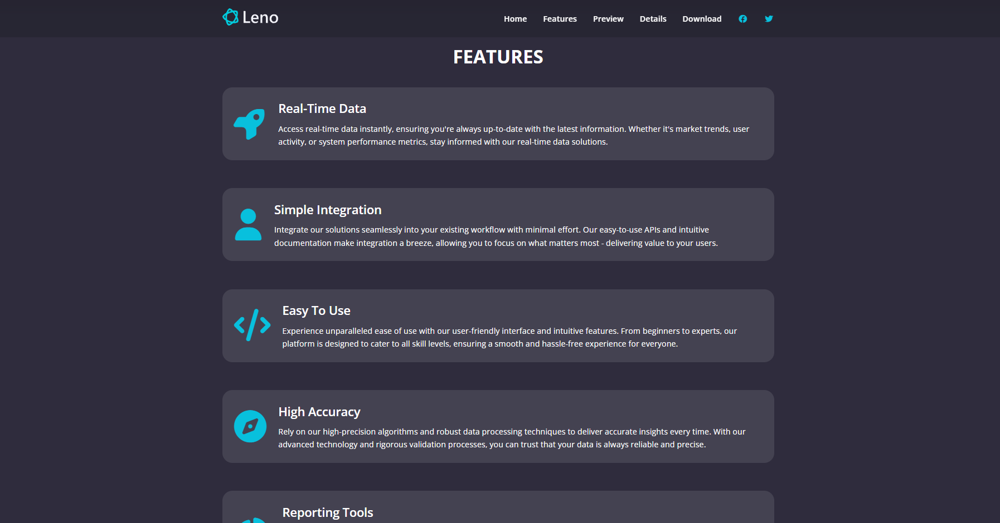
  </a>
</p>

</details>


### 2. TUTOR Website

A responsive course landing page designed around video-course creation and learning. It presents learning topics, course chapters, a structured summary, key takeaways, course details, and author information. A separate Contact page includes a message form and an embedded Google Maps location, demonstrating multi-page navigation and responsive web design.

#### Home & Learning Topics

The homepage introduces the course with a hero section, a course call-to-action, and an overview of the learning experience. The “What Will You Learn?” section presents eight visual topics covering goal setting, layout planning, creative concepts, calls to action, HTML templates, previews, coding techniques, and launching a project.

<p align="center">
  <a href="https://tutor-website-nu-six.vercel.app/">
    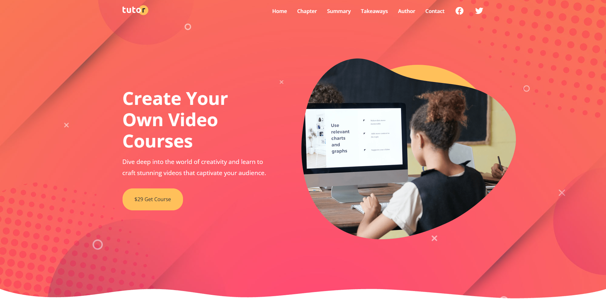
  </a>
</p>

<p align="center">
  <a href="https://tutor-website-nu-six.vercel.app/">
    <strong>View Live Website</strong>
  </a>
  ·
  <a href="./Section%2017-18%20-%20Tutor%20Website%20Project/Tutor%20Website">
    <strong>View Source Folder</strong>
  </a>
</p>

#### Main Course Chapters

The Main Course Chapters section highlights three core topics: Setting Clear Objectives, Content Creation Strategies, and Coding Essentials. Each chapter card combines an icon, title, and short description in a structured layout.

<p align="center">
  <a href="https://tutor-website-nu-six.vercel.app/#chapters">
    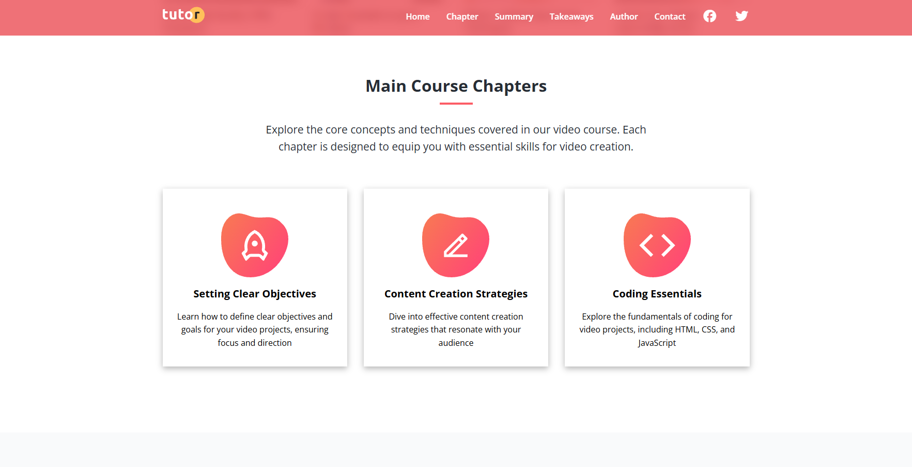
  </a>
</p>

#### Course Summary

The Course Summary section organizes learning content into three topic groups: Setting Clear Objectives, Content Creation Strategies, and From Layout to HTML/CSS. Each group contains numbered points that break the course concepts into manageable learning steps.

<p align="center">
  <a href="https://tutor-website-nu-six.vercel.app/#summary">
    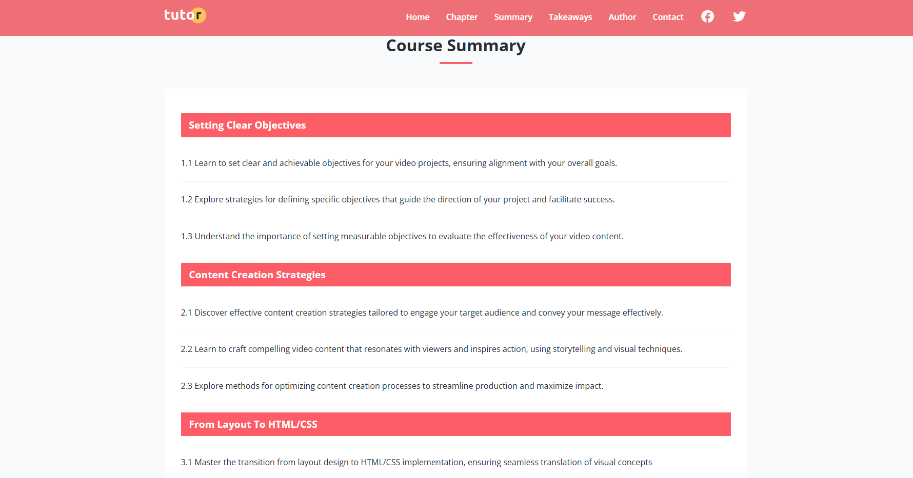
  </a>
</p>

<details>
<summary><strong>See more screenshots</strong></summary>

<br />

#### Key Takeaways

The Key Takeaways section uses an icon-based card layout to highlight six learning outcomes, including enhanced skills, a global perspective, cloud technology, networking, problem-solving, and technical proficiency.

<p align="center">
  <a href="https://tutor-website-nu-six.vercel.app/#takeaways">
    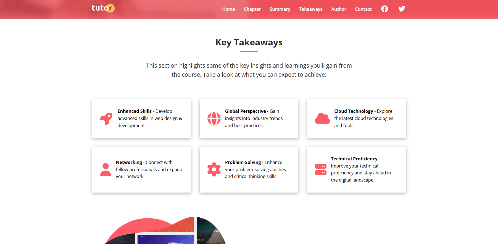
  </a>
</p>

#### Author Information

The Author Information section presents an author illustration alongside information areas for expertise, experience, and skills. Its two-column layout demonstrates how profile-related content can be arranged with supporting text and a call to action.

<p align="center">
  <a href="https://tutor-website-nu-six.vercel.app/#author">
    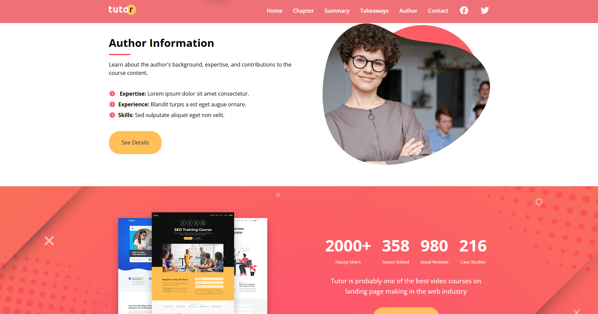
  </a>
</p>

#### Contact Form

The separate Contact page contains a contact heading, introductory text, and a form with Name, Email, and Message fields plus a Send Message button. The form is configured with a Formspree endpoint, illustrating how a frontend contact form can connect to an external form-handling service.

<p align="center">
  <a href="https://tutor-website-nu-six.vercel.app/contact.html">
    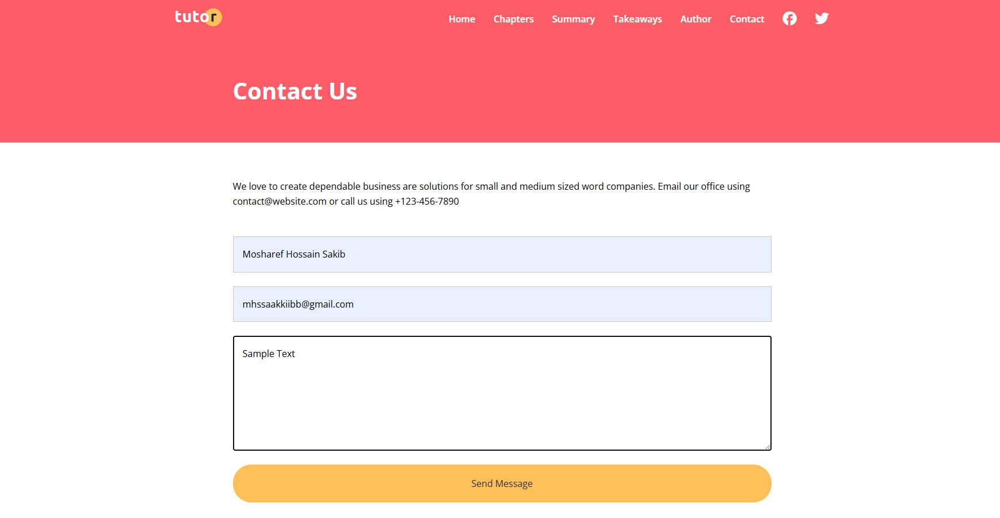
  </a>
</p>

#### Office Location - Google Maps

The Contact page also embeds Google Maps in the Office Location section. The map iframe displays the location configured in the project, demonstrating how an external map can be integrated into a website.

<p align="center">
  <a href="https://tutor-website-nu-six.vercel.app/contact.html">
    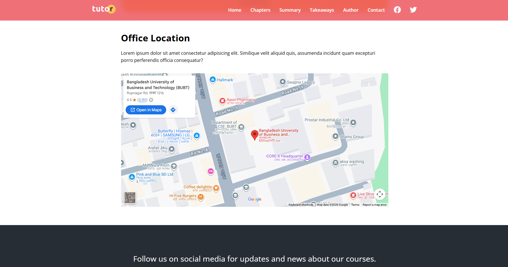
  </a>
</p>

</details>


### 3. LUMINA Creative Website

A creative-agency portfolio site that showcases work through a visual gallery and introduces the agency, its services, and team. It demonstrates page structure, image presentation, reusable styling, and responsive design.

<p align="center">
  <a href="https://modern-html-cssudemy-lumina-creativ.vercel.app/">
    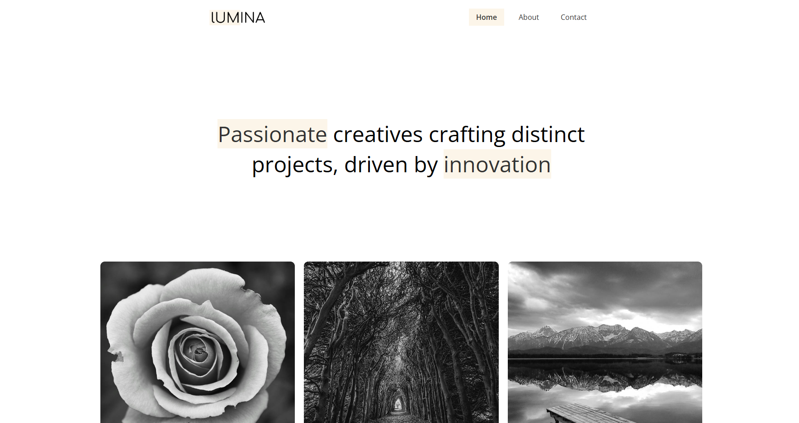
  </a>
</p>

<p align="center"><a href="https://modern-html-cssudemy-lumina-creativ.vercel.app/"><strong>🚀 View Live Website</strong></a> · <a href="./Section%2011%20-%20Lumina%20Creative%20Website%20Project/lumina-creative-project"><strong>View Source Folder</strong></a></p>


### 4. Smooth Scroll Mini-Project

A focused mini-project demonstrating smooth in-page navigation between sections. It is a useful exercise in anchor links, page navigation, and creating a more fluid browsing experience.

<p align="center">
  <a href="https://smooth-scroll-mini-project.vercel.app/">
    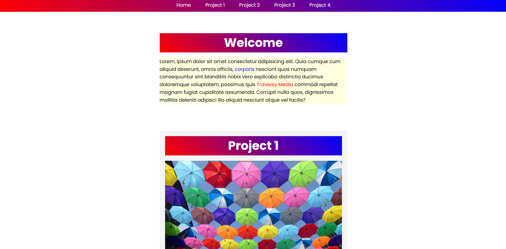
  </a>
</p>

<p align="center"><a href="https://smooth-scroll-mini-project.vercel.app/"><strong>🚀 View Live Website</strong></a></p>


### 5. BONO Landing Form

A compact landing-page mini-project focused on a promotional hero, form-oriented call to action, spacing, and flexible layout techniques—especially useful for practicing **Flexbox** and form presentation.

<p align="center">
  <a href="https://bono-landingform.vercel.app/">
    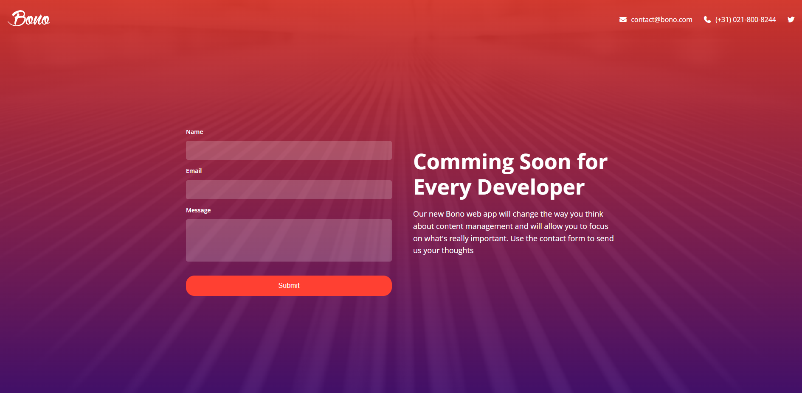
  </a>
</p>

<p align="center"><a href="https://bono-landingform.vercel.app/"><strong>🚀 View Live Website</strong></a> · <a href="./Section%209%20-%20Landing%20Form%20Mini-Project/Bono-Landing_Form"><strong>View Source Folder</strong></a></p>


## 🗺️ Learning Roadmap

| Course section | Main focus | What I practiced |
|---|---|---|
| **Section 2 — Essential HTML** | HTML foundations | Document structure, tags, attributes, and basic content elements |
| **Section 3 — HTML Forms & Inputs** | User input | Forms, labels, input types, and common form elements |
| **Section 4 — More HTML Elements** | Broader HTML toolkit | Additional semantic and structural elements |
| **Section 5 — CSS Basics** | Styling foundations | Selectors, colors, fonts, cascade, and common properties |
| **Section 6 — Box Model & Positioning** | Element sizing and placement | Margin, padding, borders, sizing, and positioning |
| **Section 7 — Flexbox** | One-dimensional layouts | Alignment, distribution, flexible sizing, and navigation layouts |
| **Section 8 — Responsive Design** | Multi-device layouts | Media queries, fluid sizing, and responsive patterns |
| **Section 9 — Bono Landing Form** | Mini-project | Putting CSS foundations and Flexbox into practice |
| **Section 10 — Various CSS Features** | Visual styling | Modern CSS effects and presentation techniques |
| **Section 11 — Lumina Creative** | Full website project | Portfolio layouts, imagery, and multi-page design |
| **Section 12 — Git, GitHub & Web Hosting** | Development workflow | Version control, remote repositories, and deployment concepts |
| **Section 13 — Web Accessibility** | Inclusive web foundations | More accessible structure and markup practices |
| **Section 14 — Advanced Selectors** | Precise styling | Pseudo-classes, pseudo-elements, and selector patterns |
| **Section 15 — CSS Grid** | Two-dimensional layouts | Grid-based page and content layouts |
| **Section 16 — Transitions, Animation & JavaScript** | Motion and interaction | Transitions, keyframes, transforms, and introductory UI behavior |
| **Sections 17–18 — TUTOR Website** | Full website project | Course-oriented sections, responsive layout, and page composition |
| **Sections 19–20 — LENO Website (BEM)** | Full website project | BEM naming, organized CSS, responsive components, and final polish |

## Tools & Technologies

- **HTML5** — semantic page structure and content.
- **CSS3** — styling, responsive layouts, Flexbox, Grid, transitions, and animation.
- **JavaScript** — introductory interactions and DOM-based behavior.
- **Git & GitHub** — version control and source-code management.
- **Visual Studio Code & Live Server** — local development and browser preview.
- **Vercel** — live deployment for the featured project demos.


## Key Learning Outcomes

By working through these modules and projects, I am building practical skills in **semantic HTML**, **clean CSS**, and **responsive web design**. I have practiced structuring layouts with **Flexbox** and **CSS Grid**, adding polish with **transitions and animations**, and improving interfaces with introductory **JavaScript**. The full projects reinforce **BEM-based CSS organization**, reusable page patterns, and a more structured frontend workflow. The repository also documents practice with **Git/GitHub** and deploying live websites through **Vercel**.

---

<p align="center">
  <strong>Learning by building — one HTML element, one CSS rule, and one project at a time.</strong>
</p>

<p align="center">
  Built and maintained by <a href="https://github.com/mhsakibb">MH Sakib</a>
</p>
